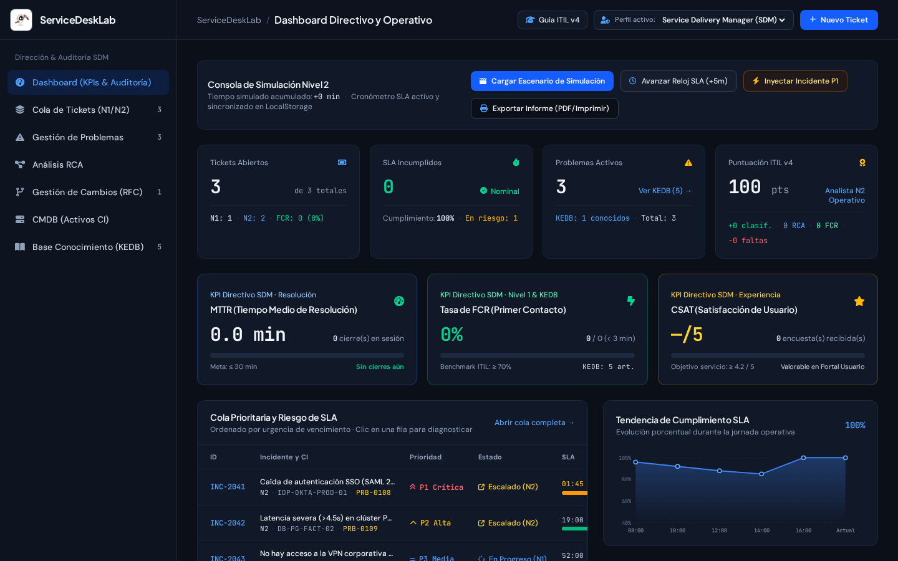
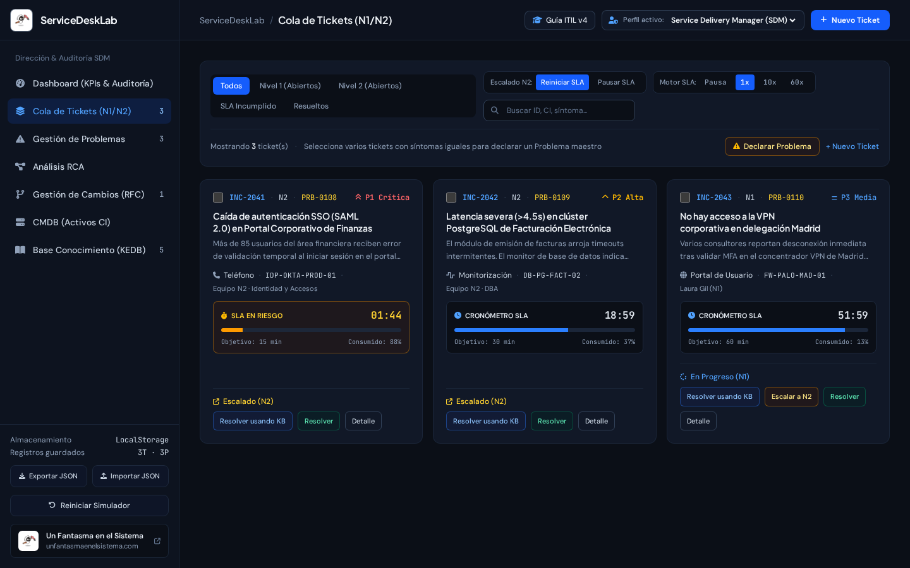
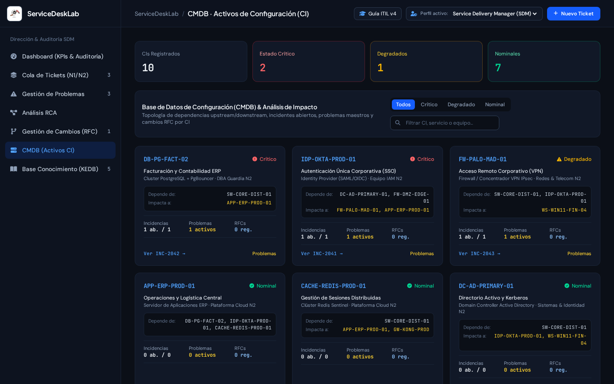
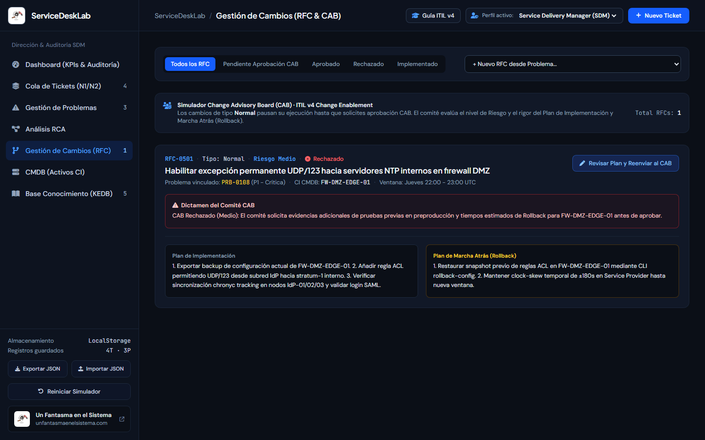
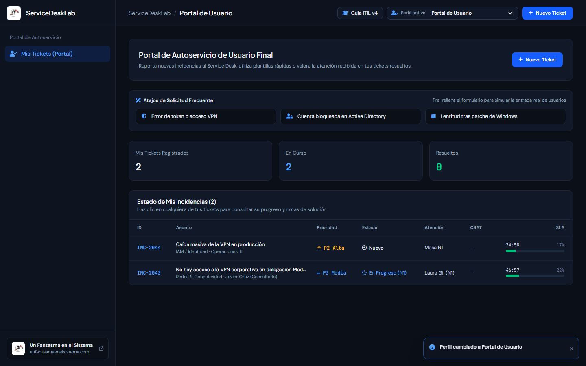
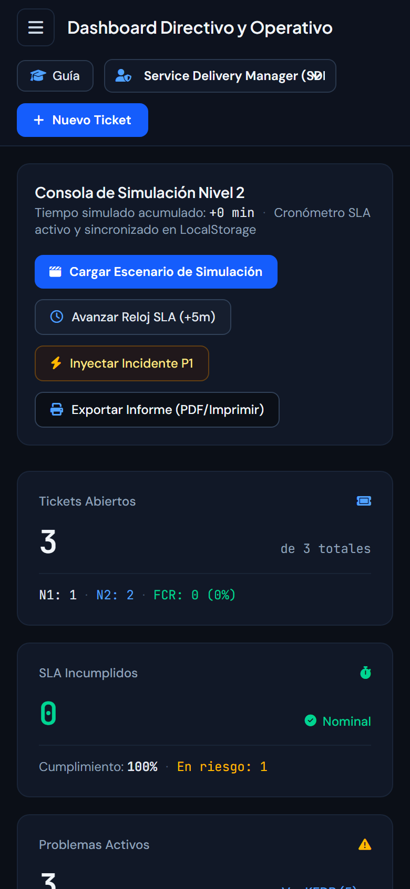

<div align="center">


# ServiceDeskLab

**Simulador Educativo Interactivo de Gestión de Servicios IT (ITIL v4) — Soporte N1, N2/N3, Problem Management, CAB y Dirección SDM**

[](./LICENSE)
[](./docs/screenshots/08-guia-itil-rubrica.png)
[](./package.json)
[](./tsconfig.json)
[](./package.json)
[](https://unfantasmaenelsistema.github.io/ServiceDeskLab/)

**[▶ Abrir el simulador](https://unfantasmaenelsistema.github.io/ServiceDeskLab/)** · [Creado por **Un Fantasma en el Sistema**](https://www.unfantasmaenelsistema.com/) · 100% en el navegador (`LocalStorage`) · Sin backend ni claves API

</div>

---

## Tabla de Contenidos

- [Descripción General](#descripción-general)
- [Capturas de Pantalla Reales](#capturas-de-pantalla-reales)
- [Funcionalidades ITIL v4 Implementadas](#funcionalidades-itil-v4-implementadas)
- [Matriz de Roles (RBAC Simulado)](#matriz-de-roles-rbac-simulado)
- [Sistema de Evaluación y Gamificación Educativa](#sistema-de-evaluación-y-gamificación-educativa)
- [Modo Aula: Escenarios, Sesiones JSON e Informes A4](#modo-aula-escenarios-sesiones-json-e-informes-a4)
- [Instalación y Desarrollo Local](#instalación-y-desarrollo-local)
- [Despliegue en GitHub Pages](#despliegue-en-github-pages)
- [Arquitectura del Proyecto](#arquitectura-del-proyecto)
- [Novedades de la versión 2](#novedades-de-la-versión-2)
- [Créditos y Licencia](#créditos-y-licencia)

---

## Descripción General

**ServiceDeskLab** es un laboratorio práctico diseñado para formación profesional, grados superiores (ASIR / DAM / DAW) y cursos de certificación **ITIL v4 / Gestión de Servicios IT**.

A diferencia de los demos estáticos, el alumno opera un **Service Desk realista** con cronómetros SLA en cuenta regresiva, matriz automática **Impacto × Urgencia**, escalado a Nivel 2 (OLA), agrupación de incidentes recurrentes en **Problemas Maestros**, diagnóstico obligatorio de **Análisis de Causa Raíz (5 Porqués + Diagrama de Ishikawa 4M)**, aprobación de **Peticiones de Cambio (RFC)** ante un comité **CAB** simulado, **Base de Conocimiento (KEDB)** con detección de **FCR**, topología **CMDB** con dependencias upstream/downstream, encuesta **CSAT** en el Portal de Usuario y un **registro de auditoría inmutable** en cada ticket y problema.

Todo el estado se persiste automáticamente en el `LocalStorage` del navegador e incluye exportación/importación de sesiones en **JSON** para entregas de aula o corrección docente.

---

## Capturas de Pantalla Reales

> Capturas de la versión 2 tomadas sobre la compilación de producción.

### 1. Dashboard Directivo (SDM), KPIs Dinámicos y Auditoría Global
> Vista ejecutiva con consola de simulación temporal, puntuación ITIL v4, **MTTR**, **Tasa de FCR**, **CSAT**, gráfico SVG de cumplimiento SLA y auditoría global consolidada.



### 2. Cola de Tickets con Cronómetro SLA en Vivo y Selección Múltiple
> Tarjetas con cuenta regresiva en tiempo real, alerta visual cuando un SLA entra en riesgo o vence, control de velocidad del motor SLA (`Pausa`, `1x`, `10x`, `60x`), política de escalado (`Reiniciar SLA` o `Pausar SLA`) y agrupación masiva para **Declarar Problema**.



### 3. Detalle de Ticket, Sugerencias KEDB (FCR) y Timeline Inmutable
> Diagnóstico integral de la incidencia con acciones de Nivel 1/Nivel 2, vinculación a CMDB/Problemas, resolución asistida por artículos KEDB (`< 3 min` para FCR) y línea temporal lateral no editable.


### 4. Gestión de Problemas y Análisis de Causa Raíz (5 Porqués + Ishikawa 4M)
> Investigación de Problemas Maestros con validación estricta de RCA antes del cierre en prioridades Alta/Crítica, cierre masivo de incidencias hijas y publicación automática en la KEDB.


### 5. CMDB Interactivo con Topología de Dependencias e Impacto
> Inventario de Configuration Items (CIs) de producción con filtro de salud (`Crítico`, `Degradado`, `Nominal`), relaciones **Depende de** / **Impacta a**, servicios de negocio afectados y apertura directa de incidentes sobre cualquier CI.



### 6. Gestión de Cambios (RFC) y Simulador de Comité CAB
> Ciclo completo de habilitación del cambio (`Estándar`, `Normal`, `Emergencia`) con **Plan de Implementación** y **Plan de Marcha Atrás (Rollback)** obligatorios. Solo el cambio Estándar de riesgo Bajo está preautorizado; los Normales los evalúa el **CAB** y los de Emergencia el **ECAB**.



### 7. Portal de Autoservicio de Usuario Final y Encuesta CSAT
> Experiencia simplificada para el usuario final con plantillas rápidas de reporte, seguimiento transparente del estado de sus tickets y valoración **CSAT (1–5 estrellas)** al resolverse una incidencia.



### 8. Guía Interactiva ITIL v4 y Rúbrica de Objetivos en Vivo
> Modal educativo accesible desde la barra superior con **8 hitos evaluables automáticamente**. Solo cuentan las acciones del alumno en la sesión: los datos de ejemplo no marcan ningún hito.


### 9. Versión móvil
> En pantallas estrechas el menú lateral pasa a un cajón y la barra superior se reparte en varias filas, sin desbordes.



---

## Funcionalidades ITIL v4 Implementadas

| Práctica ITIL v4 | Capacidades en ServiceDeskLab |
| :--- | :--- |
| **Service Desk & Incident Management** | Modal de creación de tickets con **Matriz Impacto × Urgencia** (cálculo automático `P1 - Crítica` a `P4 - Baja`), tiempos límite SLA configurados por prioridad, cuenta regresiva visual, parpadeo en rojo al vencer, escalado a **N2** con política OLA y **Workaround + Solución Definitiva** obligatorios al cierre. |
| **Knowledge Management (KEDB & FCR)** | Artículos precargados con síntomas, palabras clave y pasos operativos. Sugerencia en tiempo real al redactar un ticket nuevo y botón **"Resolver usando KB"**: si se cierra en menos de 3 minutos simulados con el artículo adecuado, registra **FCR cumplido**. |
| **Problem Management & RCA** | Agrupación de incidencias con síntomas equivalentes en un **Problema Maestro**, vinculación/desvinculación dinámica, cierre masivo de tickets hijos y obligación de completar **Los 5 Porqués** o **Diagrama de Ishikawa (4M: Máquina, Método, Material, Mano de Obra)** antes de cerrar Problemas P1/P2. Opción de publicar la solución en KEDB. |
| **Change Enablement (RFC & CAB)** | Creación de RFC desde Problemas con exigencia de **Tipo**, **Riesgo**, **Plan de Implementación** y **Plan de Rollback**. Solo el cambio *Estándar* de riesgo Bajo está preautorizado; los *Normales* van al comité **CAB** y los de *Emergencia* al **ECAB** (simulación basada en riesgo y calidad de los planes). Penalización severa si se intenta cerrar un Problema P1 sin RFC autorizado. |
| **Service Configuration Management (CMDB)** | Catálogo de **10 CIs de producción** (`IDP-OKTA-PROD-01`, `DB-PG-FACT-02`, `FW-PALO-MAD-01`, `APP-ERP-PROD-01`, `SW-CORE-DIST-01`, `DC-AD-PRIMARY-01`, etc.) con propietario técnico, criticidad, estado de salud calculado en vivo según incidencias/problemas abiertos y mapa de dependencias **upstream / downstream**. |
| **Auditoría e Informes** | Array `historyLog` inmutable en cada Ticket y Problema con fecha/hora simulada, actor e icono descriptivo. Vista limpia de **Informe Ejecutivo A4** optimizada con `@media print` (`window.print()`) para exportar a PDF. |

---

## Matriz de Roles (RBAC Simulado)

El selector **Perfil activo** en la barra superior condiciona dinámicamente la interfaz del simulador:

| Vista / Módulo | Portal de Usuario | Técnico N1 | Especialista N2/N3 | Service Delivery Manager (SDM) |
| :--- | :---: | :---: | :---: | :---: |
| **Mis Tickets (Portal + CSAT)** | ✅ | — | — | — |
| **Crear Nuevo Ticket** | ✅ | ✅ | ✅ | ✅ |
| **Cola de Tickets (N1/N2)** | — | ✅ | — | ✅ |
| **Base de Conocimiento (KEDB)** | — | ✅ | — | ✅ |
| **Gestión de Problemas** | — | — | ✅ | ✅ |
| **Análisis RCA (5 Porqués / Ishikawa)** | — | — | ✅ | ✅ |
| **Gestión de Cambios (RFC / CAB)** | — | — | ✅ | ✅ |
| **CMDB (Activos CI & Topología)** | — | — | ✅ | ✅ |
| **Dashboard Ejecutivo (MTTR, FCR, CSAT, Auditoría)** | — | — | — | ✅ |
| **Guía ITIL v4 y Rúbrica de Objetivos** | ✅ | ✅ | ✅ | ✅ |

---

## Sistema de Evaluación y Gamificación Educativa

El simulador puntúa automáticamente la toma de decisiones del alumno (base inicial: **100 pts**):

- **Bonificaciones (+)**:
  - Clasificación correcta de la matriz Impacto/Urgencia al crear tickets.
  - Resolución en primer contacto (**FCR**) usando artículos válidos de la KEDB en menos de 3 minutos simulados.
  - Finalización de diagnósticos **RCA** (5 Porqués o Ishikawa 4M) antes de cerrar Problemas graves.
  - Gestión ordenada de cambios mediante **RFC aprobado ante CAB** y publicación de nuevo conocimiento en la **KEDB**.
- **Penalizaciones (-)**:
  - Incumplimiento/vencimiento de **SLA** en tickets abiertos.
  - Intento de cierre de Problemas críticos/altos sin **RCA** documentado.
  - Intento de cierre de un Problema P1 sin contar con un **RFC** aprobado o implementado.
- **Cada acción puntúa una sola vez** por ticket, problema o cambio: rehacer un RCA, repetir un intento de cierre o crear varios RFC para el mismo problema no multiplica los puntos ni las penalizaciones. Un ticket cuyo texto no permite valorar la clasificación no suma ni resta.
- **El FCR exige el artículo adecuado**: un artículo de la KEDB solo cuenta como válido si sus palabras clave coinciden de verdad con el ticket (palabras completas o variantes, como *bloqueo*/*bloqueada*). Resolver con un artículo que no corresponde cierra el ticket, pero no suma FCR.
- **Un SLA vencido queda vencido**: aunque la política de escalado reinicie el reloj OLA en N2, el incumplimiento sigue contando en las métricas.

---

## Modo Aula: Escenarios, Sesiones JSON e Informes A4

1. **Escenarios de Simulación Progresiva**: desde el Dashboard puedes lanzar cuatro casos de sistemas y ciberseguridad (*Ataque de Ransomware encriptando el ERP*, *Caída del Switch Core en Sede Central*, *Falsa alarma por actualización masiva de Windows* y *Expiración de certificado TLS en API Gateway B2B*), que inyectan tickets de forma escalonada con llamadas simuladas de usuarios.
2. **Acelerador Temporal SLA**: avanza el reloj `+5 min` manualmente o cambia la velocidad del motor (`Pausa`, `1x`, `10x`, `60x`) para entrenar bajo presión en clase.
3. **Exportación / Importación de Sesiones (`.json`)**: desde la barra lateral puedes descargar toda la sesión del alumno e importarla en el equipo del profesor para revisar el `historyLog`, la puntuación y los RCA completados. Un fichero dañado o incompleto se rechaza con un aviso y no afecta a la sesión abierta. El JSON no va firmado: tómalo como entrega de trabajo, no como prueba de que nadie lo ha editado.
4. **Exportación de Informe A4 (PDF / Imprimir)**: genera un folio ejecutivo listo para imprimir con resumen de incidentes, cumplimiento SLA, análisis RCA y soluciones aplicadas.

---

## Instalación y Desarrollo Local

### Requisitos previos
- **[Bun](https://bun.sh/)** (el proyecto usa `bun.lock`)

### Pasos

```bash
# 1. Clonar el repositorio
git clone https://github.com/unfantasmaenelsistema/ServiceDeskLab.git
cd ServiceDeskLab

# 2. Instalar dependencias
bun install

# 3. Iniciar servidor de desarrollo (puerto 3000)
bun run dev
```

Abre en tu navegador: `http://localhost:3000`

### Comandos disponibles

| Comando | Descripción |
| :--- | :--- |
| `bun run dev` | Levanta el entorno de desarrollo con Vite en el puerto `3000`. |
| `bun run lint` | Ejecuta verificación estricta de tipos TypeScript (`tsc --noEmit`). |
| `bun run build` | Genera el bundle optimizado para producción en `./dist`. |
| `bun run preview` | Sirve localmente la build compilada de `./dist`. |

---

## Despliegue en GitHub Pages

El proyecto usa `base: './'` en `vite.config.ts` y el flujo [`.github/workflows/deploy.yml`](./.github/workflows/deploy.yml): cada `push` a `main` instala con Bun (`bun install --frozen-lockfile`), comprueba los tipos, compila `./dist` y lo publica en https://unfantasmaenelsistema.github.io/ServiceDeskLab/ (en **Settings → Pages**, la fuente es **GitHub Actions**).

---

## Arquitectura del Proyecto

```text
ServiceDeskLab/
├── .github/workflows/deploy.yml   # Compilación con Bun y despliegue en GitHub Pages
├── docs/screenshots/              # Capturas reales de la aplicación (PNG)
├── public/assets/logo.png         # Logotipo de la casa
├── src/
│   ├── components/
│   │   ├── ChangeManagementView.tsx   # Gestión de RFCs y simulador CAB / ECAB
│   │   ├── ClosureReportModal.tsx     # Informe de cierre (workaround + solución) para P1/P2
│   │   ├── CmdbView.tsx               # Inventario CMDB y topología de dependencias
│   │   ├── CreateRfcModal.tsx         # Alta de RFC con tipo, riesgo, implantación y rollback
│   │   ├── DashboardView.tsx          # KPIs SDM (MTTR, FCR, CSAT), tendencia SLA y auditoría
│   │   ├── DeclareProblemModal.tsx    # Agrupación de incidentes en Problema Maestro
│   │   ├── HistoryTimeline.tsx        # Timeline vertical inmutable por entidad
│   │   ├── ItilGuideModal.tsx         # Guía ITIL v4 y rúbrica de 8 hitos
│   │   ├── ItsmStatusHelpers.tsx      # Etiquetas e insignias de prioridad, estado y SLA
│   │   ├── KnowledgeBaseView.tsx      # Base de Conocimiento (KEDB)
│   │   ├── NewTicketModal.tsx         # Creación con matriz Impacto × Urgencia y KEDB en vivo
│   │   ├── PrintableReportModal.tsx   # Vista de impresión en folio A4 (@media print)
│   │   ├── ProblemManagementView.tsx  # Gestión de Problemas y cierre masivo
│   │   ├── RcaAnalysisView.tsx        # Laboratorio RCA por problema
│   │   ├── RcaToolsPanel.tsx          # Los 5 Porqués + Diagrama de Ishikawa (4M)
│   │   ├── ScenarioModal.tsx          # Lanzador de escenarios progresivos en clase
│   │   ├── Sidebar.tsx                # Navegación por rol + exportar/importar JSON
│   │   ├── TicketDrawer.tsx           # Detalle del ticket, resolución con KEDB (FCR) y timeline
│   │   ├── TicketQueueView.tsx        # Cola de tickets con cuenta atrás SLA en tiempo real
│   │   ├── ToastContainer.tsx         # Notificaciones no bloqueantes accesibles
│   │   ├── TopBar.tsx                 # Selector de rol, guía ITIL y Nuevo Ticket
│   │   └── UserPortalView.tsx         # Portal de usuario con plantillas rápidas y CSAT
│   ├── data/
│   │   ├── scenarios.ts               # Escenarios simulados de ciberseguridad y sistemas
│   │   └── serviceDeskStore.ts        # Motor ITIL v4, puntuación, reglas de negocio y LocalStorage
│   ├── types/
│   │   └── itsm.ts                    # Tipos TypeScript del dominio ITIL
│   ├── App.tsx                        # Orquestación global de estado y temporizadores
│   └── index.css                      # Tailwind CSS v4 y estilos @media print
├── LICENSE
├── package.json
├── tsconfig.json
└── vite.config.ts
```

---

## Novedades de la versión 2

- **Despliegue reparado**: el workflow usaba la caché de npm sin `package-lock.json` y fallaba siempre; ahora instala con Bun y publica en GitHub Pages.
- **Puntuación sin trucos**: cada acción puntúa una sola vez; antes se podían sumar puntos sin límite rehaciendo un RCA o creando tickets y RFC vacíos.
- **Cambios según ITIL 4**: un cambio Estándar solo se preautoriza si es de riesgo Bajo, y uno de Emergencia necesita el visto bueno del ECAB. Antes ambos se aprobaban solos aunque fueran de riesgo Crítico.
- **SLA vencido no se borra al escalar** con la política «Reiniciar SLA».
- **Rúbrica real**: los datos de ejemplo marcaban 3 de los 8 hitos sin hacer nada; ahora solo cuentan las acciones del alumno.
- **Tendencia SLA con datos reales** de la sesión en lugar de franjas fijas inventadas.
- **Importación segura**: un JSON incompleto ya no deja la aplicación en blanco, y un LocalStorage dañado vuelve al estado inicial.
- **Móvil** sin desbordes en la barra superior; React va en su propio fichero (el bundle principal baja de 500 kB).
- **Limpieza**: fuera las dependencias y ficheros de AI Studio que no se usaban y la copia estática duplicada de `github-pages/`, que no tenía estas correcciones.

- **KEDB sin falsos positivos**: el buscador comparaba trozos de 2 letras dentro de otras palabras («no» dentro de *notbefore*), así que casi todos los artículos «coincidían» con cualquier ticket y daban el FCR. Ahora compara palabras completas o variantes, y el FCR exige coincidencias en las palabras clave.
---

## Créditos y Licencia

- Proyecto educativo desarrollado para **Un Fantasma en el Sistema**: [https://www.unfantasmaenelsistema.com/](https://www.unfantasmaenelsistema.com/)
- Distribuido bajo licencia **MIT** — consulta el archivo [`LICENSE`](./LICENSE) para más detalles.
