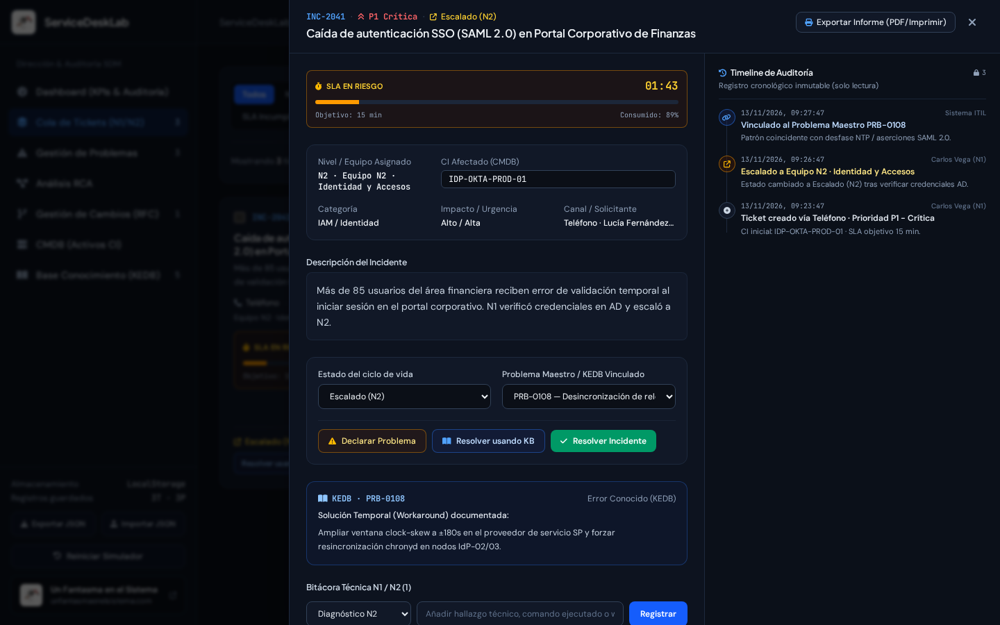
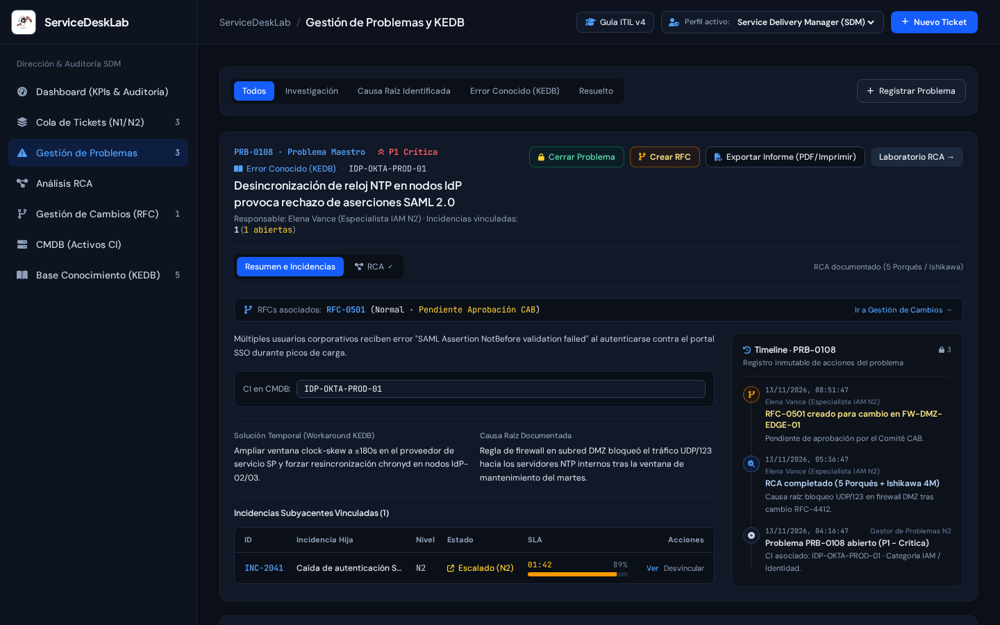
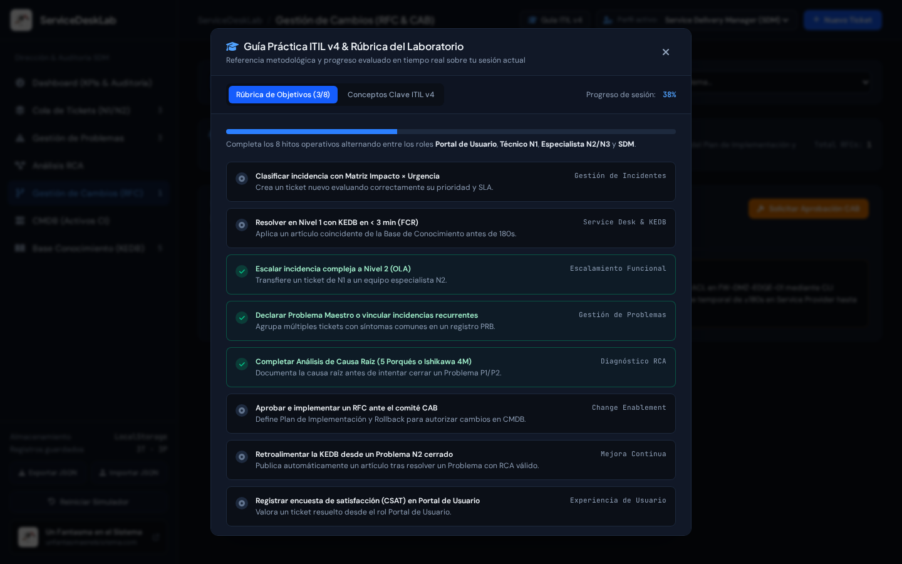

<div align="center">


# ServiceDeskLab

**Simulador Educativo Interactivo de Gestión de Servicios IT (ITIL v4) — Soporte N1, N2/N3, Problem Management, CAB y Dirección SDM**

[](./LICENSE)
[](./docs/screenshots/08-guia-itil-rubrica.png)
[](./package.json)
[](./tsconfig.json)
[](./package.json)
[](./.github/workflows/deploy.yml)

[Creado por **Un Fantasma en el Sistema**](https://www.unfantasmaenelsistema.com/) · 100% Client-Side (`LocalStorage`) · Sin backend ni claves API

</div>

---

## Tabla de Contenidos

- [Descripción General](#-descripción-general)
- [Capturas de Pantalla Reales](#-capturas-de-pantalla-reales)
- [Funcionalidades ITIL v4 Implementadas](#-funcionalidades-itil-v4-implementadas)
- [Matriz de Roles (RBAC Simulado)](#-matriz-de-roles-rbac-simulado)
- [Sistema de Evaluación y Gamificación Educativa](#-sistema-de-evaluación-y-gamificación-educativa)
- [Modo Aula: Escenarios, Sesiones JSON e Informes A4](#-modo-aula-escenarios-sesiones-json-e-informes-a4)
- [Instalación y Desarrollo Local](#-instalación-y-desarrollo-local)
- [Despliegue en GitHub Pages](#-despliegue-en-github-pages)
- [Arquitectura del Proyecto](#-arquitectura-del-proyecto)
- [Créditos y Licencia](#-créditos-y-licencia)

---

## Descripción General

**ServiceDeskLab** es un laboratorio práctico diseñado para formación profesional, grados superiores (ASIR / DAM / DAW) y cursos de certificación **ITIL v4 / Gestión de Servicios IT**.

A diferencia de los demos estáticos, el alumno opera un **Service Desk realista** con cronómetros SLA en cuenta regresiva, matriz automática **Impacto × Urgencia**, escalado a Nivel 2 (OLA), agrupación de incidentes recurrentes en **Problemas Maestros**, diagnóstico obligatorio de **Análisis de Causa Raíz (5 Porqués + Diagrama de Ishikawa 4M)**, aprobación de **Peticiones de Cambio (RFC)** ante un comité **CAB** simulado, **Base de Conocimiento (KEDB)** con detección de **FCR**, topología **CMDB** con dependencias upstream/downstream, encuesta **CSAT** en el Portal de Usuario y un **registro de auditoría inmutable** en cada ticket y problema.

Todo el estado se persiste automáticamente en el `LocalStorage` del navegador e incluye exportación/importación de sesiones en **JSON** para entregas de aula o corrección docente.

---

## Capturas de Pantalla Reales

### 1. Dashboard Directivo (SDM), KPIs Dinámicos y Auditoría Global
> Vista ejecutiva con consola de simulación temporal, puntuación ITIL v4, **MTTR**, **Tasa de FCR**, **CSAT**, gráfico SVG de cumplimiento SLA y auditoría global consolidada.


### 2. Cola de Tickets con Cronómetro SLA en Vivo y Selección Múltiple
> Tarjetas con cuenta regresiva en tiempo real, alerta visual cuando un SLA entra en riesgo o vence, control de velocidad del motor SLA (`Pausado`, `1x`, `5x`, `15x`) y agrupación masiva para **Declarar Problema**.


### 3. Detalle de Ticket, Sugerencias KEDB (FCR) y Timeline Inmutable
> Diagnóstico integral de la incidencia con acciones de Nivel 1/Nivel 2, vinculación a CMDB/Problemas, resolución asistida por artículos KEDB (`< 3 min` para FCR) y línea temporal lateral no editable.



### 4. Gestión de Problemas y Análisis de Causa Raíz (5 Porqués + Ishikawa 4M)
> Investigación de Problemas Maestros con validación estricta de RCA antes del cierre en prioridades Alta/Crítica, cierre masivo de incidencias hijas y publicación automática en la KEDB.



### 5. CMDB Interactivo con Topología de Dependencias e Impacto
> Inventario de Configuration Items (CIs) de producción con filtro de salud (`Crítico`, `Degradado`, `Nominal`), relaciones **Depende de** / **Impacta a**, servicios de negocio afectados y apertura directa de incidentes sobre cualquier CI.


### 6. Gestión de Cambios (RFC) y Simulador de Comité CAB
> Ciclo completo de habilitación del cambio (`Estándar`, `Normal`, `Emergencia`) con **Plan de Implementación** y **Plan de Marcha Atrás (Rollback)** obligatorios, además de evaluación asíncrona del comité **CAB** para cambios Normales.


### 7. Portal de Autoservicio de Usuario Final y Encuesta CSAT
> Experiencia simplificada para el usuario final con plantillas rápidas de reporte, seguimiento transparente del estado de sus tickets y valoración **CSAT (1–5 estrellas)** al resolverse una incidencia.


### 8. Guía Interactiva ITIL v4 y Rúbrica de Objetivos en Vivo
> Modal educativo accesible desde la barra superior con **8 hitos evaluables automáticamente** sobre la sesión actual y referencia rápida de conceptos clave de ITIL v4.



---

## Funcionalidades ITIL v4 Implementadas

| Práctica ITIL v4 | Capacidades en ServiceDeskLab |
| :--- | :--- |
| **Service Desk & Incident Management** | Modal de creación de tickets con **Matriz Impacto × Urgencia** (cálculo automático `P1 - Crítica` a `P4 - Baja`), tiempos límite SLA configurados por prioridad, cuenta regresiva visual, parpadeo en rojo al vencer, escalado a **N2** con política OLA y **Workaround + Solución Definitiva** obligatorios al cierre. |
| **Knowledge Management (KEDB & FCR)** | Artículos precargados con síntomas, palabras clave y pasos operativos. Sugerencia en tiempo real al redactar un ticket nuevo y botón **"Resolver usando KB"**: si se cierra en menos de 3 minutos simulados con el artículo adecuado, registra **FCR cumplido**. |
| **Problem Management & RCA** | Agrupación de incidencias con síntomas equivalentes en un **Problema Maestro**, vinculación/desvinculación dinámica, cierre masivo de tickets hijos y obligación de completar **Los 5 Porqués** o **Diagrama de Ishikawa (4M: Máquina, Método, Material, Mano de Obra)** antes de cerrar Problemas P1/P2. Opción de publicar la solución en KEDB. |
| **Change Enablement (RFC & CAB)** | Creación de RFC desde Problemas con exigencia de **Tipo**, **Riesgo**, **Plan de Implementación** y **Plan de Rollback**. Los cambios *Normales* solicitan aprobación al comité **CAB** (simulación realista basada en riesgo y calidad de planes). Penalización severa si se cierra un Problema crítico afectando la CMDB sin RFC autorizado. |
| **Service Configuration Management (CMDB)** | Catálogo de **10 CIs de producción** (`FW-PERIM-01`, `ERP-PROD-01`, `AUTH-AD-01`, `SW-CORE-01`, `VPN-GW-01`, etc.) con propietario técnico, criticidad, estado de salud calculado en vivo según incidencias/problemas abiertos y mapa de dependencias **upstream / downstream**. |
| **Auditoría e Informes** | Array `historyLog` inmutable en cada Ticket y Problema con fecha/hora simulada, actor e icono descriptivo. Vista limpia de **Informe Ejecutivo A4** optimizada con `@media print` (`window.print()`) para exportar a PDF. |

---

## Matriz de Roles (RBAC Simulado)

El selector **Perfil activo** en la barra superior condiciona dinámicamente la interfaz del simulador:

| Vista / Módulo | Portal de Usuario | Técnico N1 | Especialista N2/N3 | Service Delivery Manager (SDM) |
| :--- | :---: | :---: | :---: | :---: |
| **Mis Tickets (Portal + CSAT)** | ✅ | — | — | — |
| **Crear Nuevo Ticket** | ✅ | ✅ | ✅ | ✅ |
| **Cola de Tickets (N1/N2)** | — | ✅ | — | ✅ |
| **Base de Conocimiento (KEDB)** | — | ✅ | — | ✅ |
| **Gestión de Problemas** | — | — | ✅ | ✅ |
| **Análisis RCA (5 Porqués / Ishikawa)** | — | — | ✅ | ✅ |
| **Gestión de Cambios (RFC / CAB)** | — | — | ✅ | ✅ |
| **CMDB (Activos CI & Topología)** | — | — | ✅ | ✅ |
| **Dashboard Ejecutivo (MTTR, FCR, CSAT, Auditoría)** | — | — | — | ✅ |
| **Guía ITIL v4 y Rúbrica de Objetivos** | ✅ | ✅ | ✅ | ✅ |

---

## Sistema de Evaluación y Gamificación Educativa

El simulador puntúa automáticamente la toma de decisiones del alumno (base inicial: **100 pts**):

- **Bonificaciones (+)**:
  - Clasificación correcta de la matriz Impacto/Urgencia al crear tickets.
  - Resolución en primer contacto (**FCR**) usando artículos válidos de la KEDB en menos de 3 minutos simulados.
  - Finalización de diagnósticos **RCA** (5 Porqués o Ishikawa 4M) antes de cerrar Problemas graves.
  - Gestión ordenada de cambios mediante **RFC aprobado ante CAB** y publicación de nuevo conocimiento en la **KEDB**.
- **Penalizaciones (-)**:
  - Incumplimiento/vencimiento de **SLA** en tickets abiertos.
  - Intento de cierre de Problemas críticos/altos sin **RCA** documentado.
  - Cierre de un Problema que afecta a producción en la **CMDB** sin contar con un **RFC** aprobado o implementado.

---

## Modo Aula: Escenarios, Sesiones JSON e Informes A4

1. **Escenarios de Simulación Progresiva**: desde el Dashboard puedes lanzar casos reales de sistemas y ciberseguridad (*Ataque de Ransomware encriptando el ERP*, *Caída del Switch Core*, *Falsa alarma por actualización de Windows*), inyectando tickets de forma escalonada con llamadas simuladas de usuarios en tiempo real.
2. **Acelerador Temporal SLA**: avanza el reloj `+5 min` manualmente o cambia la velocidad del motor (`1x`, `5x`, `15x`) para entrenar bajo presión en clase.
3. **Exportación / Importación de Sesiones (`.json`)**: desde la barra lateral puedes descargar toda la sesión del alumno en un archivo JSON validado e importarlo en el equipo del profesor para auditar el `historyLog`, la puntuación y los RCA completados.
4. **Exportación de Informe A4 (PDF / Imprimir)**: genera un folio ejecutivo listo para imprimir con resumen de incidentes, cumplimiento SLA, análisis RCA y soluciones aplicadas.

---

## Instalación y Desarrollo Local

### Requisitos previos
- **Node.js 20+** y **npm**

### Pasos

```bash
# 1. Clonar el repositorio
git clone https://github.com/<tu-usuario>/servicedesklab.git
cd servicedesklab

# 2. Instalar dependencias
npm install

# 3. Iniciar servidor de desarrollo (puerto 3000)
npm run dev
```

Abre en tu navegador: `http://localhost:3000`

### Comandos disponibles

| Comando | Descripción |
| :--- | :--- |
| `npm run dev` | Levanta el entorno de desarrollo con Vite en el puerto `3000`. |
| `npm run lint` | Ejecuta verificación estricta de tipos TypeScript (`tsc --noEmit`). |
| `npm run build` | Genera el bundle optimizado para producción en `./dist`. |
| `npm run preview` | Sirve localmente la build compilada de `./dist`. |

---

## Despliegue en GitHub Pages

El repositorio incluye **dos opciones listas para usar**:

### Opción A — Despliegue automático con GitHub Actions (Recomendada)

El proyecto ya tiene configurado `base: './'` en `vite.config.ts` y el flujo [`.github/workflows/deploy.yml`](./.github/workflows/deploy.yml):

1. Sube este repositorio a GitHub en la rama `main`.
2. Ve a **Settings → Pages → Build and deployment → Source** y selecciona **GitHub Actions**.
3. Cada `push` a `main` ejecutará `npm ci`, `npm run lint`, `npm run build` y publicará automáticamente `./dist` en GitHub Pages.

### Opción B — Carpeta estática sin compilación (`/github-pages`)

Si necesitas publicar directamente en un servidor estático o mediante rama/carpeta sin paso de build en Node.js, la carpeta [`/github-pages`](./github-pages) contiene una versión autónoma en `index.html`, `style.css` y `app.js`.

---

## Arquitectura del Proyecto

```text
servicedesklab/
├── .github/workflows/deploy.yml   # CI/CD automático para GitHub Pages
├── docs/screenshots/              # Capturas reales de la aplicación
├── github-pages/                  # Versión estática autónoma sin compilación
├── public/assets/aistudio/        # Logotipo corporativo
├── src/
│   ├── components/
│   │   ├── ChangeManagementView.tsx   # Gestión de RFCs y simulador CAB
│   │   ├── CmdbView.tsx               # Inventario CMDB y topología de dependencias
│   │   ├── DashboardView.tsx          # KPIs SDM (MTTR, FCR, CSAT), gráficos y auditoría
│   │   ├── DeclareProblemModal.tsx    # Agrupación de incidentes en Problema Maestro
│   │   ├── HistoryTimeline.tsx        # Timeline vertical inmutable por entidad
│   │   ├── ItilGuideModal.tsx         # Guía ITIL v4 y rúbrica dinámica de 8 hitos
│   │   ├── KnowledgeBaseView.tsx      # Base de Conocimiento (KEDB)
│   │   ├── NewTicketModal.tsx         # Creación con matriz Impacto × Urgencia y KEDB live
│   │   ├── PrintableReportModal.tsx   # Vista de impresión en folio A4 (@media print)
│   │   ├── ProblemManagementView.tsx  # Gestión de Problemas y cierre masivo
│   │   ├── RcaToolsPanel.tsx          # Los 5 Porqués + Diagrama de Ishikawa (4M)
│   │   ├── ScenarioModal.tsx          # Lanzador de escenarios progresivos en clase
│   │   ├── Sidebar.tsx                # Navegación condicionada por rol + JSON Export/Import
│   │   ├── TicketDetailModal.tsx      # Gestión completa del ticket y resolución FCR
│   │   ├── TicketQueueView.tsx        # Cola de tickets con SLA countdown en tiempo real
│   │   ├── ToastContainer.tsx         # Notificaciones no bloqueantes accesibles
│   │   ├── TopBar.tsx                 # Selector de rol RBAC, guía ITIL y Nuevo Ticket
│   │   └── UserPortalView.tsx         # Portal de usuario con plantillas rápidas y CSAT
│   ├── data/
│   │   ├── scenariosData.ts           # Escenarios simulados de ciberseguridad y sistemas
│   │   └── serviceDeskStore.ts        # Motor ITIL v4, reglas de negocio y LocalStorage
│   ├── types/
│   │   └── itsm.ts                    # Definiciones estrictas TypeScript del dominio ITIL
│   ├── App.tsx                        # Orquestación global de estado y temporizadores
│   └── index.css                      # Configuración Tailwind CSS v4 y estilos @media print
├── LICENSE
├── package.json
├── tsconfig.json
└── vite.config.ts
```

---

## Créditos y Licencia

- Proyecto educativo desarrollado para **Un Fantasma en el Sistema**: [https://www.unfantasmaenelsistema.com/](https://www.unfantasmaenelsistema.com/)
- Distribuido bajo licencia **MIT** — consulta el archivo [`LICENSE`](./LICENSE) para más detalles.
